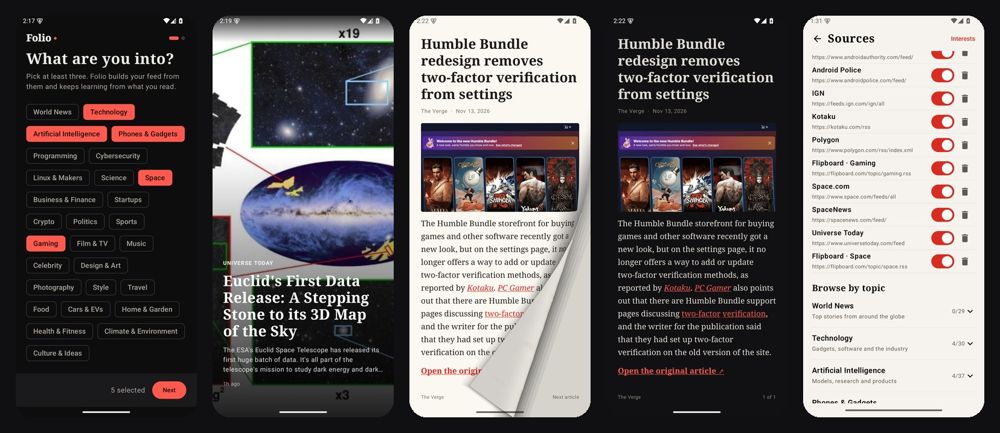
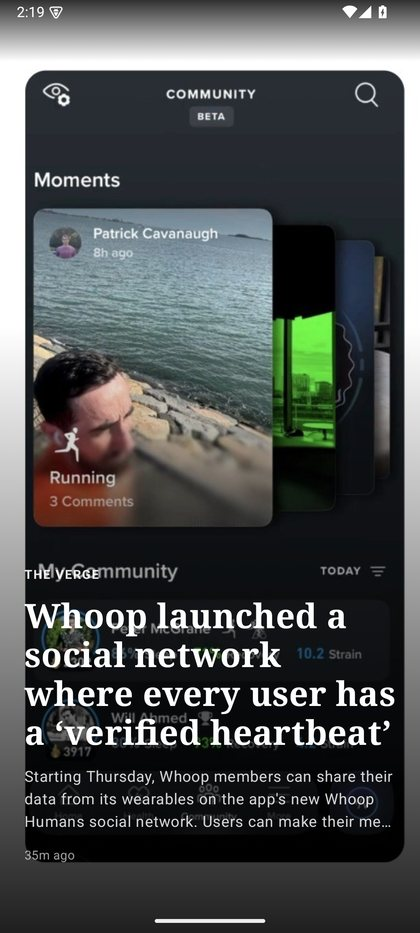
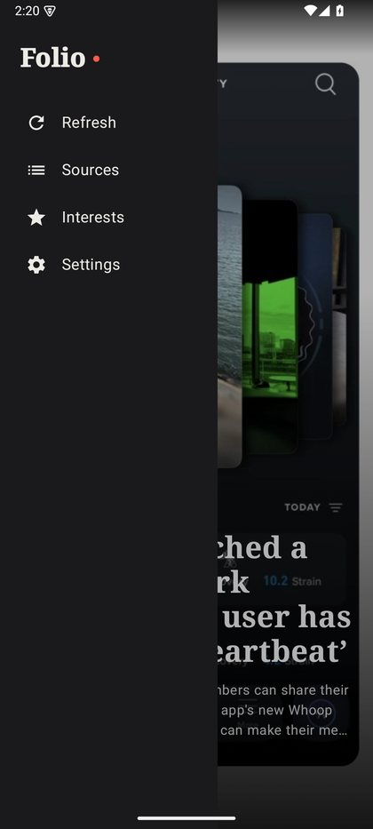
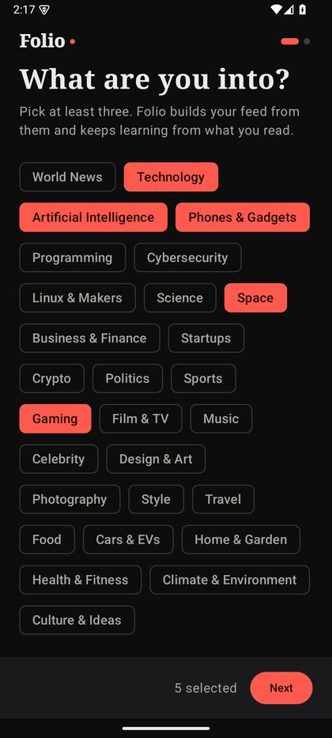
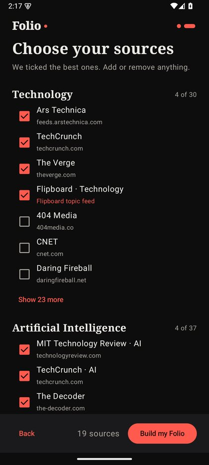
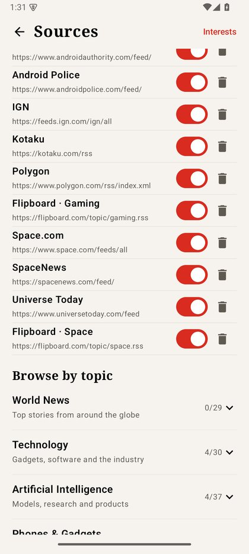
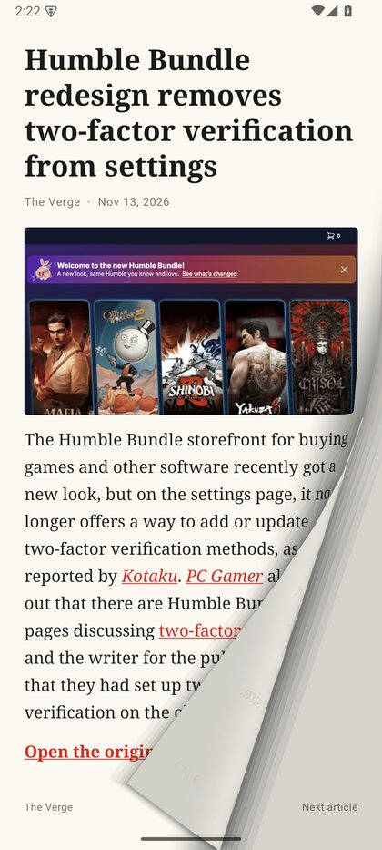
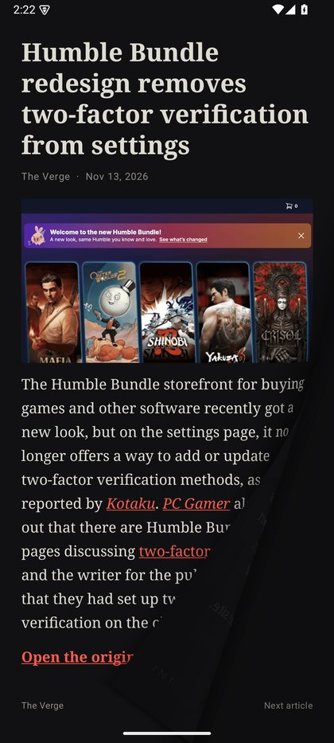

<p align="center">
  
</p>

<h1 align="center">Folio</h1>

<p align="center">
  <strong>The Open Source Flipboard Alternative for Android</strong><br>
  <em>Page-flip news feed • Kindle-style page-curl reader • 785+ built-in RSS sources • on-device "For You" algorithm</em>
</p>

<p align="center">
  <a href="https://github.com/fspecii/folio-news-reader/releases/latest">
    
  </a>
  <a href="https://github.com/fspecii/folio-news-reader/stargazers">
    
  </a>
</p>

<p align="center">
  <a href="#-demo">Demo</a> •
  <a href="#-why-folio">Why Folio</a> •
  <a href="#-features">Features</a> •
  <a href="#-the-for-you-algorithm">Algorithm</a> •
  <a href="#-built-in-sources">Sources</a> •
  <a href="#-installation">Installation</a> •
  <a href="#-usage">Usage</a> •
  <a href="#-contributing">Contributing</a>
</p>

<p align="center">
  
  
  
  
  
  
  
</p>

---

## 🎬 Demo

<p align="center">
  
</p>

<p align="center">
  <em>A news reader that feels like a magazine: flip through stories, then read them page by page with a real page curl.</em>
</p>

| Flip home feed | Flip home feed | Side panel | Interests wizard |
|:---:|:---:|:---:|:---:|
|  |  |  |  |

| Pick sources | Source browser | Page curl (light) | Page curl (dark) |
|:---:|:---:|:---:|:---:|
|  |  |  |  |

---

## 🚀 Why Folio?

**Tired of feeds full of ads, popups and algorithms that you can't see?** Folio is a **beautiful, minimal RSS news reader** for Android that gives you the **Flipboard flip** and the **Kindle page turn**, with a personalisation engine that runs **entirely on your phone**.

| Feature | Flipboard / Google News | Folio |
|---------|------------------------|-------|
| **Cost** | Free with ads | **Free, open source** |
| **Account required** | Yes | **No account, ever** |
| **Ads & sponsored stories** | Yes | **None** |
| **Tracking & analytics** | Yes | **None, zero network calls except to your sources** |
| **Personalisation** | Cloud profile | **On-device "For You" model you can reset** |
| **Reading** | Mixed in-app/web | **100% in-app reader, paginated like a book** |
| **Page turn** | Scroll | **Kindle-style page curl with back-face & shadows** |
| **Foldables** | Stretched phone UI | **Two-page book spread on the unfolded screen** |
| **Sources** | Their catalog | **785+ verified feeds + any website you paste** |

---

## ✨ Features

### 📖 Kindle-style reading
| Feature | Description |
|---------|-------------|
| **Real page curl** | The page peels from the corner you touch on a textured mesh: diagonal fold, mirrored back face with the text ghosting through, shaded roll, soft shadow on the next page |
| **True pagination** | Articles are split into real pages with widow/orphan control, so you turn pages instead of scrolling |
| **Two-page spread** | On a foldable's inner screen (or any wide display) Folio shows two pages like an open book |
| **Swipe or tap** | Swipe anywhere (even starting on text or a link), or tap the left/right third of the screen |
| **Keep going** | Swipe past the last page and the **next story** curls in, no menus needed |
| **Tappable links** | Links inside articles open in your browser; every article ends with "Open the original article ↗" |
| **Adjustable type** | A− / A+ repaginate instantly; serif reading typography, warm paper in light mode |
| **Light & dark** | System, light or dark; paper and ink colours tuned for both |

### 🗞️ Flipboard-style flip feed
| Feature | Description |
|---------|-------------|
| **Page-flip animation** | The lower half of each story folds up on a centre hinge with perspective and shading; swipe back to unfold |
| **Rich story layouts** | Full-bleed hero, image + text, text + image, and a typographic layout for stories without a picture |
| **Auto images** | Feeds without pictures get their `og:image` fetched in the background |
| **Hidden controls** | The logo, refresh, sources and settings stay out of the way. Swipe right to reveal them |

### 🧭 Sources, wizard and discovery
| Feature | Description |
|---------|-------------|
| **785+ built-in sources** | 631 publisher RSS feeds + 154 Flipboard topic feeds, all tested, in 28 topics |
| **Setup wizard** | Pick what you're into, then tick the sources you want (the best ones are pre-selected) |
| **Browse & search** | Expand any topic, search the whole catalog, toggle sources on/off |
| **Add anything** | Paste a website or feed URL and Folio auto-discovers the RSS/Atom feed |
| **De-duplication** | The same story arriving from several feeds is shown once |
| **Offline start** | The last feed is cached, so the app opens instantly |

### 🔒 Private by design
| Feature | Description |
|---------|-------------|
| **No accounts** | Nothing to sign up for |
| **No analytics SDKs** | The only network traffic is to the feeds and articles you choose |
| **On-device learning** | Your reading profile lives in app storage and can be wiped with one tap |

---

### 🆕 New in 1.1
- **Daily briefing cover** – a Flipboard-style "Good morning" first page with the top 5 stories from different publishers
- **Magazines** – save stories with the star, or file them into your own collections
- **Mute publishers**, **share** stories, new adaptive + themed icon
- **Auto-update from GitHub** – Folio checks the latest release on launch (Settings → Updates) and installs it through the system installer

## 🧠 The "For You" algorithm

Folio ranks your feed with a small on-device model, so the first page is the one you'd most likely open:

```
score = recency × interest(topic) × trust(source) × quality × (1 + keywords) × feed-rank
```

| Signal | How it works |
|--------|--------------|
| **Recency** | Half-life of 10 hours, so breaking news beats yesterday's long reads |
| **Interest** | Your wizard topics start high; every open, finished article and skip nudges them |
| **Source trust** | Opened vs. flicked-past stories per publisher (smoothed so one tap doesn't swing it) |
| **Keywords** | Words from titles you open build a decaying interest profile |
| **Quality** | Small bonus for stories with a picture and a real summary |
| **Feed rank** | Editorial order from the feed (e.g. Flipboard topic feeds) acts as a popularity hint |
| **Already read** | Stories you opened sink to the bottom |
| **Diversity** | Greedy re-rank: never five stories from one site in a row, and a story from an unfamiliar topic every ninth slot to keep you exploring |

Turn **Smart feed** off in Settings for plain newest-first, or **Reset what Folio learned** to start fresh.

---

## 🌍 Built-in sources

28 topics, **785 sources**, every feed validated when the catalog was built:

| Topic | Sources | Topic | Sources | Topic | Sources |
|-------|:------:|-------|:------:|-------|:------:|
| World News | 29 | Technology | 30 | Artificial Intelligence | 37 |
| Phones & Gadgets | 29 | Programming | 38 | Cybersecurity | 21 |
| Linux & Makers | 14 | Science | 37 | Space | 19 |
| Business & Finance | 39 | Startups | 9 | Crypto | 12 |
| Politics | 26 | Sports | 48 | Gaming | 34 |
| Film & TV | 35 | Music | 28 | Design & Art | 43 |
| Photography | 22 | Style | 31 | Travel | 27 |
| Food | 20 | Cars & EVs | 20 | Home & Garden | 10 |
| Celebrity | 28 | Health & Fitness | 28 | Climate & Environment | 28 |
| Culture & Ideas | 43 | | | | |

**How the catalog was built** (see [`tools/`](tools)): hand-picked feeds were validated with `validate.py`; Flipboard's public topic pages and `flipboard.com/topic/<slug>.rss` feeds were crawled politely (`flipboard.py`) to learn which publishers sit under which topic; `discover.py` auto-discovered a working RSS feed for each of those publishers; `build_catalog.py` merged everything into [`catalog.json`](app/src/main/assets/catalog.json). Re-run the scripts any time to refresh it.

---

## 📦 Installation

### Option 1: Download the APK (easiest)

1. Grab **`Folio-v1.0.0.apk`** from the [latest release](https://github.com/fspecii/folio-news-reader/releases/latest)
2. Open it on your phone and allow *Install unknown apps* for your browser or file manager when asked
3. Open **Folio** and follow the 30-second setup wizard

Requires **Android 8.0 (API 26)** or newer. Optimised for the **Galaxy Z Fold** family and other foldables or tablets, and works great on any phone.

### Option 2: Build from source

```bash
git clone https://github.com/fspecii/folio-news-reader.git
cd folio-news-reader
# needs JDK 17+ and the Android SDK (platform 35); set sdk.dir in local.properties
./gradlew assembleRelease        # or assembleDebug
adb install app/build/outputs/apk/release/app-release.apk
```

> The release build is signed with the debug key so you can sideload it straight away. Use your own keystore if you publish a fork.

---

## 🎮 Usage

| Where | Gesture | What it does |
|-------|---------|--------------|
| Home | **Swipe up / down** | Flip to the next / previous story |
| Home | **Tap** | Open the story in the reader |
| Home | **Swipe right** | Show the hidden panel (refresh, sources, interests, settings) |
| Reader | **Swipe left / right** | Curl to the next / previous page (start anywhere, even on text) |
| Reader | **Tap right / left third** | Next / previous page |
| Reader | **Tap the middle** | Show or hide the menu (back, Open in browser, A−/A+, settings) |
| Reader | **Swipe past the last page** | Curl straight into the next story |
| Reader | **Tap a link** | Open it in your browser |

---

## 🛠️ Tech stack

| Layer | Tech |
|-------|------|
| **UI** | Kotlin 2.0, Jetpack Compose, Material 3 |
| **Page curl** | Cylinder-wrap mesh drawn with `drawVertices` over a captured `GraphicsLayer` texture |
| **Flip** | Compose `graphicsLayer` with `rotationX`, camera distance and per-half clipping |
| **Pagination** | `TextMeasurer` line-by-line layout with widow/orphan and keep-with-next rules |
| **Networking** | OkHttp with disk cache |
| **Feed parsing** | `XmlPullParser` for RSS 2.0 / Atom / RDF, with feed auto-discovery |
| **Article extraction** | Jsoup with a Readability-style content picker, images and inline links preserved |
| **Images** | Coil |
| **Storage** | SharedPreferences + a JSON feed cache, no database, no accounts |

```
app/src/main/java/dev/folio/news/
├── MainActivity.kt        # edge-to-edge shell, overlays, back handling
├── AppViewModel.kt        # feeds, ranking, onboarding, learning events
├── data/                  # Feeds, Extractor, Ranker, Catalog, Prefs, Models
└── ui/                    # FlipPager, CurlPager, ReaderScreen, HomeScreen,
                           # OnboardingScreen, SourcesScreen, SettingsSheet
tools/                     # catalog build scripts (validate, crawl, discover, build)
```

---

## 🗺️ Roadmap

- [ ] OPML import / export
- [ ] Save for later + offline reading
- [ ] Per-topic sections on the home screen
- [ ] Optional full-text search across fetched stories
- [ ] Text-to-speech reading
- [ ] More languages and regional source packs

---

## 🤝 Contributing

Contributions are welcome. Good first issues: add or fix feeds in [`tools/candidates.py`](tools/candidates.py) and rebuild the catalog, improve article extraction for a stubborn site, or tune the page-curl lighting. Open an issue or a pull request.

---

## ⚖️ License & disclaimer

[MIT](LICENSE). Folio is an independent project and is **not affiliated with, endorsed by or sponsored by Flipboard, Inc. or Amazon**. "Flipboard" and "Kindle" are trademarks of their respective owners and are used only to describe the style of interaction. No code or assets from those apps are included. The page-curl and page-flip effects are original implementations. Stories, headlines and images shown in screenshots belong to their publishers and are loaded live from public RSS feeds; please respect each publisher's terms.

---

<p align="center">
  <sub><strong>Keywords:</strong> Flipboard alternative · open source news reader Android · RSS reader Android · Kindle page curl animation · page turn animation Jetpack Compose · foldable news app · Galaxy Z Fold reader · Material 3 news app · private news reader no ads · on-device personalised news feed</sub>
</p>

<p align="center">
  If Folio makes your mornings better, a ⭐ helps others find it.
</p>
